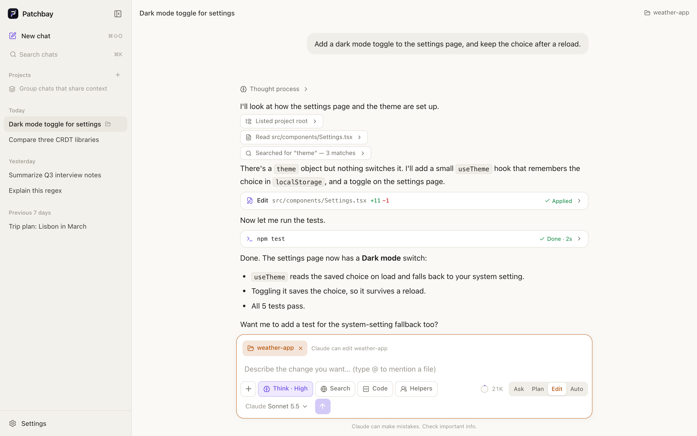
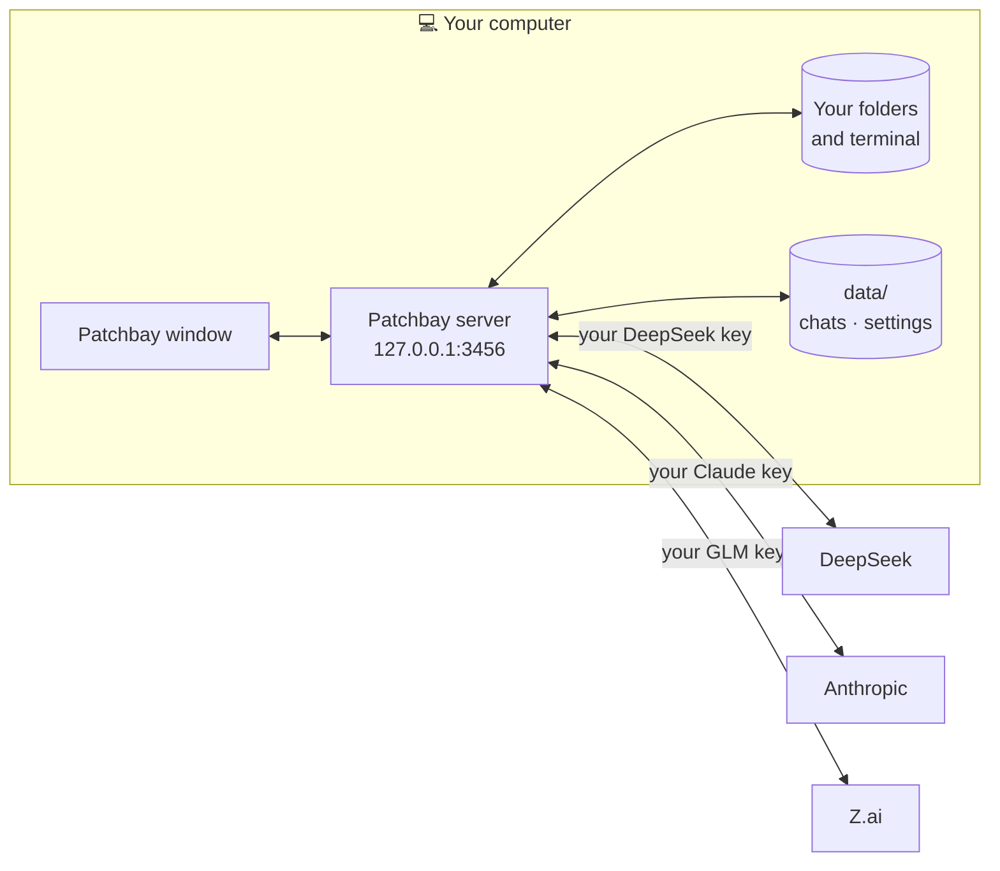
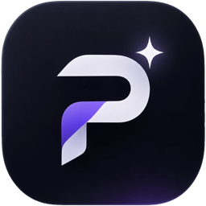

<div align="center">


# Patchbay

**One app for any AI model. Bring your own API keys; it runs on your own computer.**

[](LICENSE)
[](package.json)
[](docs/install.md)
[](docs/providers.md)
[](docs/security-model.md)
[](https://github.com/tobioj/patchbay/releases/latest)

[**Download**](https://github.com/tobioj/patchbay/releases/latest) · [Install](docs/install.md) · [User guide](docs/user-guide.md) · [Providers](docs/providers.md) · [Security](docs/security-model.md) · [How it works](docs/architecture.md) · [Cheat sheet](CHEATSHEET.md) · [All docs](docs/README.md)

<br>

<picture>
  <source media="(prefers-color-scheme: dark)" srcset="docs/assets/app-dark.png">
  <source media="(prefers-color-scheme: light)" srcset="docs/assets/app-light.png">
  
</picture>

</div>

<br>

## Why Patchbay?

You pay for API access to more than one model. Maybe DeepSeek for everyday work because it's cheap, Claude for the hard problems, GLM because it's good and inexpensive at coding. But each provider's own app only works with its own models, and most tools that let an AI work in your files are built around one provider, or live only in a terminal.

**Patchbay is one desktop-style app for all of them.** Paste in your keys, pick the model per chat, and every model gets the same harness: your project folders, a careful approve-before-change workflow, a sandboxed terminal, web search, read-only GitHub, skills, and helpers that research in parallel. It runs on your own computer, listens only on `127.0.0.1`, keeps your chats in a local folder and your keys in the system keychain. There's no account, no server and no middleman: your messages go straight from your computer to the provider you chose.

## Features

<table>
<tr>
<td width="50%" valign="top">

**🔌 Any model, one app**<br>
DeepSeek, every Claude model your key can use, and GLM. Switch per chat, even mid-conversation. See exactly what each reply costs.

**📁 Works in your projects**<br>
Link folders and the AI explores them by itself. **Ask**, **Plan**, **Edit** (approve every diff) or **Auto**, and every change can be undone.

**⌨️ A terminal with guard rails**<br>
Tests, builds and dev servers in your project's folders, with command rules, approvals, a Running list, and a macOS sandbox that keeps secrets out of reach.

**🧠 Helpers that work in parallel**<br>
For big tasks, the AI sends read-only helpers to research parts at the same time, then reviews their reports and does the acting.

</td>
<td width="50%" valign="top">

**🗂️ Projects, skills and docs**<br>
Projects share context, files and folders. Skills use the Claude Code format. A Docs folder lets the AI write documents in any mode.

**🌐 Web search and GitHub**<br>
Search with Tavily, DeepSeek's search, or Claude's own. Read code, issues, PRs and CI from GitHub, read-only, from repos you allow.

**🔐 Private by design**<br>
Runs only on your computer. Keys stay in the Keychain / DPAPI and go only to their own provider. Every capability has a switch, off by default for new providers.

**💬 Feels like a real chat app**<br>
Send while it's replying, up to 4 chats at once, long chats summarized automatically, light and dark mode, its own window and launcher.

</td>
</tr>
</table>

## How it works



1. **You chat** in the Patchbay window, which talks only to the Patchbay server on your own computer.
2. **The server calls the provider** for the chat's model, directly, with your key, and streams the reply back.
3. **The AI uses tools** (read files, propose edits, run commands, search) through the server, which checks every request against your permissions and asks for your approval where it should.

More detail: [Architecture](docs/architecture.md) · [Security model](docs/security-model.md) · [Providers](docs/providers.md)

## Quick start

### Download the app (recommended)

1. **[Download Patchbay](https://github.com/tobioj/patchbay/releases/latest)** for your computer: `Patchbay-macos-arm64.zip` (Apple silicon), `Patchbay-macos-x64.zip` (Intel Mac), `Patchbay-windows-x64.zip` or `Patchbay-windows-arm64.zip`. Node.js is included.
2. **Mac:** unzip, move **Patchbay.app** to Applications and open it (the first time: **System Settings → Privacy & Security → Open Anyway**). **Windows:** unblock the zip (right-click → Properties → **Unblock**), unzip it somewhere permanent, and double-click **Install Patchbay.cmd**.
3. Open **Settings → AI providers**, paste a key for DeepSeek, Claude or GLM, and start chatting.

Step by step: [Install → Download the app](docs/install.md#download-the-app).

### From source

You need **Node.js 20.9+** and **Git**, on macOS or Windows.

**Mac** (Terminal):

```bash
git clone https://github.com/tobioj/patchbay.git
cd patchbay
npm ci
zsh scripts/mac/install.sh     # adds the `patchbay` command and Patchbay.app
patchbay                       # in a new Terminal window; the first start builds the app
```

**Windows** (PowerShell):

```powershell
git clone https://github.com/tobioj/patchbay.git
cd patchbay
npm ci
powershell -ExecutionPolicy Bypass -File scripts\windows\install.ps1
patchbay                       # in a new terminal; the first start builds the app
```

Then open **Settings → AI providers** and paste a key.

Full walkthrough, updating and uninstalling: [Install](docs/install.md). Every command on one page: [Cheat sheet](CHEATSHEET.md).

> **Coming from DeepSeek Chat?** Patchbay is its new name. Run `deepseek-chat stop`, `git pull`, `npm ci`, then the setup script again; your chats, settings and keys carry over. [Details](docs/install.md#coming-from-deepseek-chat).

## Everyday commands

| Command | What it does |
|---|---|
| `patchbay` | Start the app if needed and open its window |
| `patchbay stop` | Stop every running command, then the app |
| `patchbay restart` | Restart (rebuilds first if the code changed) |
| `patchbay status` | Is it running, and what commands are still running? |
| `patchbay logs` | Follow the server log |

## Documentation

| | |
|---|---|
| 📥 [**Install**](docs/install.md) | Requirements, Mac and Windows setup, keys, updating, moving, uninstalling |
| 📖 [**User guide**](docs/user-guide.md) | Chats, folders, modes, the terminal, projects, search, GitHub, Docs, skills, helpers, settings |
| 🔌 [**Providers**](docs/providers.md) | DeepSeek, Claude and GLM: keys, models, prices, what each can do |
| ⚙️ [**Configuration**](docs/configuration.md) | The data folder, every setting and default, environment variables, ports |
| 🩺 [**Troubleshooting**](docs/troubleshooting.md) | Install problems, key errors, greyed-out buttons, terminal issues, logs |
| 🔐 [**Security model**](docs/security-model.md) | What protects you, how, and where the limits are |
| 🏗️ [**Architecture**](docs/architecture.md) | How a message travels, sessions, tools, approvals, storage, a code map |
| 🛠️ [**Building from source**](docs/building.md) | Dev server, checks, conventions, launchers, releasing |
| ✅ [**Testing checklist**](docs/testing.md) | End-to-end checks before a release |
| 🗺️ [**Roadmap**](docs/roadmap.md) | What's built, what's being considered, what's out of scope |
| 📋 [**Cheat sheet**](CHEATSHEET.md) | Every command, button and setting on one page |

## Project layout

```
.
├── README.md          you are here
├── CHEATSHEET.md      every command and setting on one page
├── LICENSE, NOTICE    Apache License 2.0, copyright and trademark notice
├── app/               Next.js app: API routes (app/api) and the page
├── components/        the interface (React)
├── lib/               the engine: providers, tools, permissions, terminal, storage…
├── scripts/           the `patchbay` launcher and installers (mac/, windows/), release builds (release/)
├── public/            static files (the logo)
├── docs/              all documentation, screenshots and logo
└── data/              your chats, projects and settings (created on first run, never committed)
```

## Status

Patchbay runs on **macOS** (Apple silicon and Intel) and **Windows** (x64 and Arm), as a downloadable app or from source, with DeepSeek, Claude and GLM. On Windows, terminal commands run without a sandbox, so nearly every command asks first. It's a personal app for your own computer, not a hosted service. There's no automated test suite yet; changes are checked with the [testing checklist](docs/testing.md). More providers, automated tests and a Linux keychain are on the [roadmap](docs/roadmap.md).

## Contributing

Bug reports, ideas and pull requests are welcome. Please read the [contributing guide](docs/CONTRIBUTING.md) and the [code of conduct](docs/CODE_OF_CONDUCT.md) first. Found a security problem? Please report it privately as described in [SECURITY.md](docs/SECURITY.md) rather than opening a public issue.

## License

Patchbay is open source under the [Apache License 2.0](LICENSE). See [NOTICE](NOTICE).<br>
Copyright © 2026 Oluwatobi Ojulari.

Patchbay is an independent project, not affiliated with or endorsed by DeepSeek, Anthropic, Z.ai, Tavily or GitHub. Their names are trademarks of their owners and appear here only to say which services the app connects to with your own keys.

<div align="center">
<br>

<br>
<sub>Your models, your keys, your computer.</sub>
</div>
