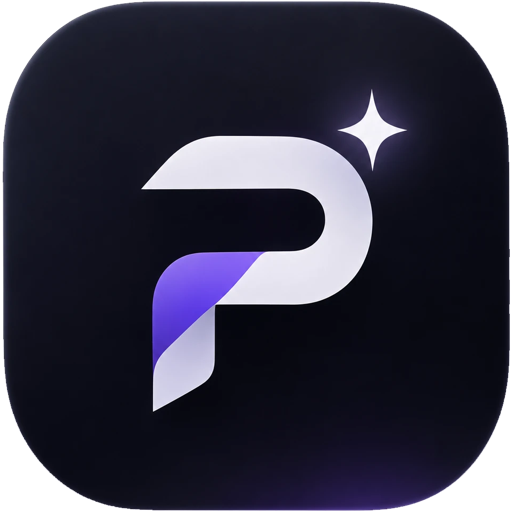

# Patchbay documentation

Everything about using, understanding and building Patchbay. New here? Start with **Install**, then the **User guide**. Want every command and setting on one page? See the [cheat sheet](../CHEATSHEET.md).

## Using Patchbay

| Guide | What's in it |
|---|---|
| [Install](install.md) | Requirements, installing on macOS and Windows, adding a key, the `patchbay` command, updating, moving, uninstalling |
| [User guide](user-guide.md) | Chats, models, attachments, folders, Ask / Plan / Edit / Auto, the terminal, projects, web search, GitHub, Docs, skills, helpers, long chats, settings, shortcuts |
| [Providers](providers.md) | DeepSeek, Claude and GLM: keys, models, prices, what each can do, web search, thinking and effort |
| [Configuration](configuration.md) | The data folder, API keys, every setting with its default, environment variables, ports, backups |
| [Troubleshooting](troubleshooting.md) | Install problems, key and provider errors, greyed-out buttons, folders, the terminal, logs |
| [Cheat sheet](../CHEATSHEET.md) | Every command, button and setting on one page |

## Understanding Patchbay

| Guide | What's in it |
|---|---|
| [Security model](security-model.md) | What protects you, how, and where the limits are: the local server, keys, permissions, folders, the terminal sandbox, prompt injection |
| [Architecture](architecture.md) | How a message travels, provider sessions, tools, permissions, approvals, helpers, storage, API routes, a map of the code, adding a provider |
| [Roadmap](roadmap.md) | What's built, what's next, and what's out of scope |

## Working on Patchbay

| Guide | What's in it |
|---|---|
| [Building from source](building.md) | Toolchain, dev server, a separate data folder, checks, conventions, launchers, prices, icons, releasing |
| [Testing checklist](testing.md) | Manual end-to-end tests to run before a release or after risky changes |
| [Contributing](CONTRIBUTING.md) | How to report bugs, suggest features and send pull requests |
| [Code of conduct](CODE_OF_CONDUCT.md) | How we treat each other here |
| [Security policy](SECURITY.md) | How to report a vulnerability privately |

## Glossary

| Term | Meaning |
|---|---|
| **Provider** | A company whose models Patchbay can use with your key: DeepSeek, Anthropic (Claude) or Z.ai (GLM). |
| **The AI** | The model a chat is using. Each chat picks its own, and can switch. |
| **Harness** | Everything Patchbay gives a model besides the conversation: tools, modes, approvals, the terminal, helpers. The same for every provider. |
| **Tool** | Something the AI can ask Patchbay to do: read a file, search, edit, run a command, search the web. Shown as cards in the reply. |
| **Folder** | A folder on your computer linked to a chat or project, which the AI can explore (and, in Edit / Auto, change). |
| **Project** | A group of chats sharing context, files, folders and settings. |
| **Mode** | Ask, Plan, Edit or Auto: how much the AI may do with a chat's folders. |
| **Approval** | Your OK for a file change or command, given on its card. |
| **What … may do** | The per-provider switches in Settings that set the most each AI is ever allowed to do. |
| **Run without asking** | A per-chat switch that lets ordinary commands run without an approval (risky ones still ask). |
| **Running list** | Every command still running, from any chat, with its log and a Stop button. |
| **Look-only command** | A command that only reads inside the project (`ls`, `cat`, `git status`…); it never needs approval. |
| **Sandbox** | On macOS, the system-level fence around commands: writes only in the project, no secrets, internet off by default. |
| **Docs folder** | A folder where the AI may create and update documents in any mode. |
| **Skill** | A folder with a `SKILL.md` of instructions the AI opens when a task matches. Same format as Claude Code. |
| **Helper** | A separate, read-only run of the chat's model that researches one task and reports back. |
| **Brain** | The chat's own AI, when it's directing helpers. |
| **Summary** | What replaces the early part of a long chat when it's sent to the model. |
| **Token ring** | The meter by the model menu: how full the conversation is, and what it costs. |
| **Data folder** | `data/` in the app folder: every chat, project, skill and setting. |
| **Launcher** | The `patchbay` command that builds, starts, stops and opens the app. |
