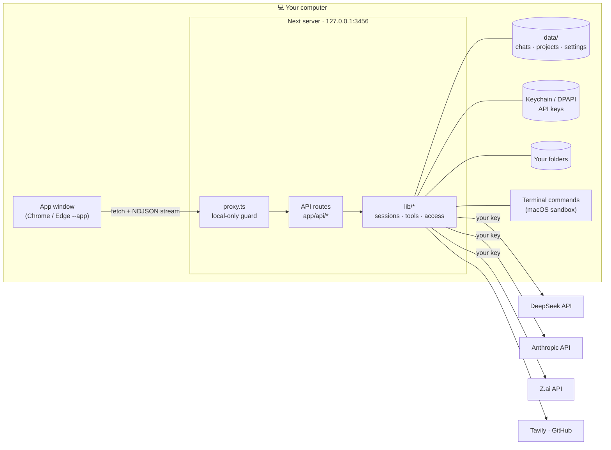
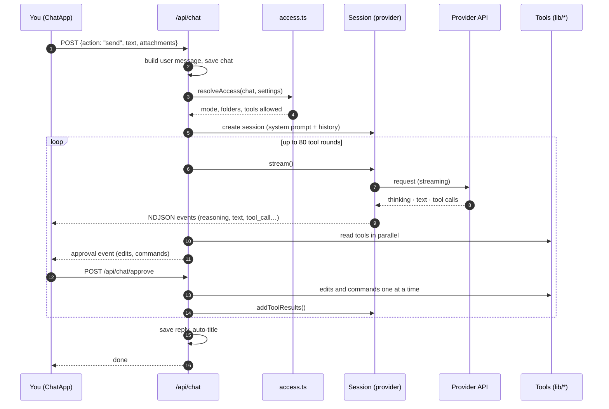
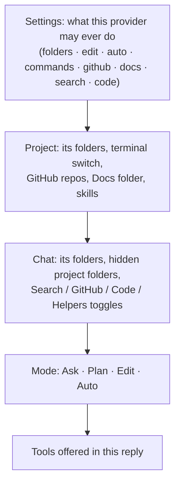
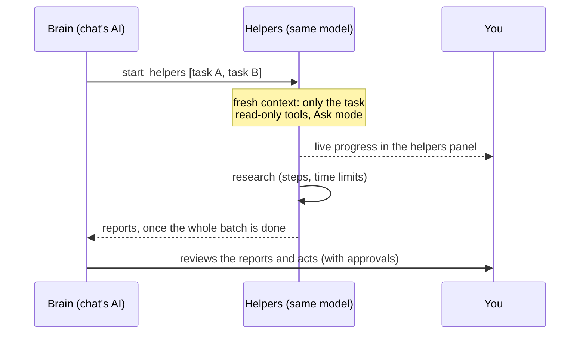

# Architecture

A readable tour of how Patchbay is put together, for contributors. All paths are relative to the repository root. If a detail here and the code disagree, the code wins (and please open an issue or PR to fix the doc).

**Contents:** [The big picture](#the-big-picture) · [Processes](#processes) · [How a message travels](#how-a-message-travels) · [Provider sessions](#provider-sessions) · [Tools](#tools) · [Permissions](#permissions) · [Approvals](#approvals) · [Sending while it's replying](#sending-while-its-replying) · [Helpers](#helpers) · [Long chats](#long-chats) · [Terminal commands](#terminal-commands) · [Storage](#storage) · [The interface](#the-interface) · [API routes](#api-routes) · [Code map](#code-map) · [Dependencies](#dependencies) · [Adding a provider](#adding-a-provider)

## The big picture

Patchbay is a **Next.js 16 app that runs only on your own computer**. The browser window is the interface; the Next server does everything else: it holds your keys, talks to the model providers, reads and edits your folders, and runs commands.



Three ideas shape the code:

- **The server is the trusted side.** Keys never reach the browser, and every file, command and network call happens in `lib/` on the server, behind [the permission layers](#permissions) and [approvals](#approvals).
- **One harness, many models.** The tools, modes, approvals, helpers and storage are shared. Only the *session* (how to call a provider and read its stream) differs per provider.
- **Everything is a file you own.** Chats, projects and settings are plain JSON in `data/`, so backing up or moving Patchbay is copying one folder.

## Processes

| Process | Started by | Notes |
|---|---|---|
| **Next server** (`next start -H 127.0.0.1 -p 3456`, or the standalone `server.js` in the downloaded app) | The launcher (`scripts/mac/patchbay`, `scripts/windows/patchbay.ps1`) | Runs in the background; log in `server.log`. `npm run dev` uses port 3455 instead. |
| **App window** | The launcher | `--app=` window of Chrome (or Edge on Windows), otherwise the default browser |
| **Terminal commands** | `lib/sandbox.ts` `spawnCommand` | macOS: `sandbox-exec` + `zsh`, in their own process group. Windows: PowerShell 7 (`pwsh`) or Windows PowerShell 5.1. |
| **Helpers** | `lib/helpers.ts` | Not separate processes: background async runs inside the server |
| **Small system tools** | Various | `git` (folder status), `security` (Keychain), PowerShell (DPAPI, dialogs), AppleScript (dialogs), `lsof` / `ps` (ports, process trees) |

`instrumentation.ts` runs once when the server starts (Node runtime only). It calls `initProcesses()`, which kills commands a crash left running (recorded in `data/processes.json`) and installs an exit hook that stops every command tree when the server exits.

`proxy.ts` (Next 16's name for middleware) guards every `/api/*` request: the `Host` must be `127.0.0.1`, `localhost` or `[::1]`, an `Origin` header (if present) must match the host, and `Sec-Fetch-Site: cross-site` is refused. See [Security model](security-model.md#the-local-server).

## How a message travels



1. **Client.** `ChatApp.send()` creates the chat if needed (`POST /api/chats`), shows your message straight away, and opens `POST /api/chat` with `action: "send"` (other actions: `regenerate`, `edit`, `helpers`). If a reply is already streaming in that chat, the message goes to the [queue](#sending-while-its-replying) instead. At most 4 chats stream at once (`MAX_REPLIES`, client-side).
2. **The user message.** `buildUserMessage()` in `lib/conversation.ts` folds text attachments into the message, saves images and PDFs to `data/uploads`, and keeps PDF text for models that can't read PDFs.
3. **Access.** `resolveAccess()` works out what the AI may do right now: see [Permissions](#permissions).
4. **Summary.** If the chat is past its long-chat threshold, it's summarized first: see [Long chats](#long-chats).
5. **Session.** The provider comes from the model id (`providerOf()` in `lib/models.ts`: `deepseek*` → DeepSeek, `glm*` → GLM, anything else → Claude). The system prompt is assembled in `lib/conversation.ts` in this order: your Settings instructions, project context and files, today's date, the folder section (folder maps and the mode's instructions), then the Terminal, Docs, GitHub, Web search and Code sections, helpers, skills, and a final "your tools right now" list. Project context goes first because it rarely changes, so providers can cache it.
6. **The tool loop** (`app/api/chat/route.ts`, up to `MAX_TOOL_ROUNDS = 80`). Each round:
   - delivers any queued messages and finished helper reports;
   - streams one model call, forwarding thinking, text and tool calls as events;
   - runs **read tools in parallel** (folders, docs reads, web, GitHub, skills, helper tools, `check_command`, `stop_command`);
   - turns **edits, `save_document` and `run_command` into jobs**: previewed as diffs, sent through [approvals](#approvals), then run **one at a time, in order**;
   - hands the results back to the session.

   The loop ends when the model answers without tool calls. A cut-off answer (`length`) gets a "continue" note; a refusal gets a note; Claude's `pause_turn` continues the loop.
7. **Saving.** Empty steps are dropped, the reply is saved right after the message it answers, and a chat still called "New chat" gets an automatic title from the provider's small model (Claude Haiku 4.5, V4.1 Flash with thinking off, or GLM-5.3 Flash), falling back to the first seven words.

### The event stream

The response is newline-delimited JSON (`application/x-ndjson`), one event per line. Event types (`lib/types.ts`): `user`, `start`, `step`, `reasoning`, `text`, `tool_call`, `tool_result`, `approval`, `command`, `command_output`, `split`, `step_cut`, `status`, `summary`, `ping`, `usage`, `title`, `error`, `done`. A `ping` goes out every 15 seconds while waiting for an approval or a command, and command output is batched every 150 ms. The client reads it with `readEvents()` in `lib/client.ts`.

## Provider sessions

Every provider implements the same `ModelSession` interface (`lib/session.ts`): stream a step, add tool results, add user messages, force a final answer.

| Session | File | Provider specifics |
|---|---|---|
| `DeepSeekSession` | `lib/session.ts` | OpenAI-style client (`openai` package). `thinking: enabled/disabled`, `reasoning_effort: high/max`. Past reasoning is sent back when tools and thinking are on. Reports cache hits as `prompt_cache_hit_tokens`. |
| `GlmSession` | `lib/session.ts` (extends `DeepSeekSession`) | Always thinks (`clear_thinking: false`, so reasoning is preserved), effort low/high/max, `max_tokens: 65536`, streamed tool calls. Maps `sensitive` → refusal, `model_context_window_exceeded` → context error. |
| `ClaudeSession` | `lib/claude-session.ts` | Anthropic SDK (beta messages). Adaptive or budget thinking, `output_config.effort`, the system prompt cached with `cache_control`. Re-sends Claude's own content blocks (with thinking signatures) unchanged when it can. Adds Anthropic's server tools (web search, web fetch, code execution) and optional model fallback. If the API rejects a request option, it learns that, retries without it (up to 6 times), and remembers for next time. |

`lib/providers.ts` picks the OpenAI-style client and session (`openAIClient`, `openAISession`) and the right error messages (`friendlyErrorFor`). Claude's client and its model list (from the Models API, cached for 12 hours in `data/claude-models.json`) are in `lib/claude.ts`.

## Tools

| Family | Tools (names sent to the model) | Defined in |
|---|---|---|
| **Folders (read-only)** | `list_directory`, `read_file`, `search_files`, `find_files` | `lib/tools.ts`, file access in `lib/files.ts` |
| **Edits** | `edit_file`, `write_file`, `delete_file` | `lib/edits.ts` (backups and undo too) |
| **Terminal** | `run_command`, `check_command`, `stop_command` | `lib/terminal.ts`; rules in `lib/commands.ts` |
| **Docs folder** | `save_document`, `list_documents`, `read_document` | `lib/docs.ts` (`save_document` becomes an edit job) |
| **GitHub (read-only)** | `github_list_repos`, `github_browse`, `github_search_code`, `github_issues`, `github_pull_requests`, `github_commits`, `github_ci_runs` | `lib/github.ts` |
| **Web (DeepSeek, GLM)** | `web_search`, `read_webpage` | `lib/websearch.ts` (Tavily or DeepSeek's search) |
| **Web and code (Claude)** | Anthropic server tools: `web_search`, `web_fetch`, `code_execution` | `lib/claude-session.ts`, run on Anthropic's servers |
| **Skills** | `use_skill`, `read_skill_file` | `lib/skills.ts` |
| **Helpers** | `start_helpers`, `wait_for_helpers`, `check_helpers`, `stop_helpers` | `lib/helper-tools.ts`, `lib/helpers.ts` |

The set offered in a given reply is assembled in `lib/access.ts`. A tool that's switched off mid-chat disappears from the list, and earlier calls to it are shown to the model as short `[Earlier: …]` notes.

## Permissions

`lib/access.ts` decides what the AI may do for each reply. Each layer **can only take away**:



- **Mode** is forced to Ask with no folder open; Edit and Auto fall back to Ask if the provider may not change files, and Auto falls back to Edit if it may not use Auto mode.
- **Web search** needs the provider's switch and the chat's toggle; DeepSeek and GLM also need **Settings → Web search** on and a key for the chosen service.
- **Terminal** needs the provider's switch and a project with Terminal on; commands run only in that project's own folders.
- **GitHub** needs the switch, the chat toggle, a token, and at least one repo allowed by both Settings and the project.
- **Code execution** is Claude only.

The per-provider switches and their defaults are in `lib/models.ts` (`ProviderLimits`) and `lib/storage.ts` (`DEFAULT_SETTINGS.limits`).

## Approvals

Edits and commands that need your OK pause the reply until you answer.

1. The route re-reads the chat, settings and project (you may have switched mode while it was working).
2. **Edits** need approval unless Auto applies (the provider may use Auto, and the chat is in Auto mode), or the edit is a Docs save you've marked *don't ask again*.
3. **Commands** follow `needsApproval()` in `lib/commands.ts`: look-only never asks; risky always asks; in Ask and Plan mode the rest ask; otherwise an *Always allow* rule or **Run without asking** skips the question; without the macOS sandbox it always asks; otherwise it asks unless the chat is in Auto.
4. For each call that needs you, the route emits an `approval` event and waits in `waitForApproval()` (`lib/approvals.ts`), which parks a resolver in a `globalThis` map keyed by chat and call.
5. `POST /api/chat/approve` resolves it. **Approve all** only covers edits; every command needs its own click. A command you edited on its card is checked again before it runs. Stopping the reply rejects the wait.

## Sending while it's replying

`lib/queue.ts` keeps a per-chat queue in `globalThis` while a reply is in progress.

- `POST /api/chat/queue` adds a message (or cancels one, or asks to answer now). It returns 409 if the reply has already ended, and the client then sends normally.
- At the start of each tool round, the route takes queued messages and **splits** the reply: the part written so far is saved, your messages are inserted after it, and the model continues with them (`split` event).
- After a final answer, `finishOrTake()` either takes messages that arrived meanwhile and keeps going, or closes the queue, atomically, so nothing slips between.
- **Answer together now** aborts only the current model call, keeps what was written (ending in " …"), and starts again with your message (`step_cut` event).
- On Stop or an error, waiting messages go back to the message box.

## Helpers

Helpers let the chat's AI (the "brain") send read-only researchers in parallel (`lib/helpers.ts`, `lib/helper-tools.ts`).



- `startHelpers()` starts up to `helpersMax − running` tasks as one **batch**, registers them in `globalThis`, saves them to `chat.helperRuns`, and runs them in the background.
- Each helper runs the chat's own model in a fresh chat containing only its task, in Ask mode, with only read tools: folders, Docs reads, web, GitHub and skills. No edits, no terminal, no Docs saves, no helpers of its own.
- **Limits** (Settings → Helpers): helpers at once (default 4, range 1–8), steps per helper (30, 5–100), minutes per helper (15, 1–60). At a limit, the helper is told to answer now, with 3 minutes' grace to write its report.
- **Reports return per batch**, once every helper in it has finished: into the brain's current reply at its next round, through `wait_for_helpers`, or, if the brain had finished, in an automatic reply the window starts (it polls `/api/helpers`). After 3 automatic replies in a row it waits for you. The brain can start at most 3 rounds of helpers per reply.
- The chat's Stop doesn't stop helpers; you stop them in the panel, and the brain with `stop_helpers`.

## Long chats

`lib/summarize.ts`. A summary is due when the last reply's context size reaches the lower of **Settings → Long chats** (default 200,000 tokens; 0 means never) and 80% of the model's context window.

| Chat's model | Who writes the summary |
|---|---|
| Newer Claude models | Claude itself (Anthropic's compaction); the returned block is stored and re-sent as-is |
| Other Claude models | The chat's own model, from a text transcript |
| DeepSeek | V4.1 Flash, thinking off |
| GLM | GLM-5.3 Flash |

The summary is saved as `chat.summary` and replaces the messages it covers when the conversation is sent; you still see them all. Its cost is added to the chat's total. It runs at the start of a reply, or when you click **Summarize**.

## Terminal commands

- **Spawning** (`lib/processes.ts` → `lib/sandbox.ts`). Each command gets an id and lives in a `globalThis` map. Output is stripped of terminal colour codes; the log keeps the first 8,000 and last 2 million characters. Live state is mirrored to `data/processes.json` so a crash can be cleaned up.
- **Environment.** Commands get a minimal environment with your login `PATH`, **never Patchbay's keys**. Git push URLs point nowhere, credential helpers are cleared, and SSH runs without identities.
- **The macOS sandbox** (`sandbox-exec` profile in `lib/sandbox.ts`): writes only to the project's folders and temp/cache paths; no access to secrets (SSH keys, Keychains, browser data, Patchbay's data folder…); `security`, `osascript`, `open`, `sudo` and `gh` can't run; internet off unless the project allows it; Patchbay's own ports always off-limits. In Ask and Plan mode the project folders are read-only too.
- **Classification** (`lib/commands.ts`): `look`, `ask`, `always_ask`, `blocked`. Details in [Security model → Terminal](security-model.md#terminal-commands).
- **Time limits** apply to the AI's foreground commands (10, 30 or 60 minutes per project). Background commands return once a port opens, the process exits or 8 seconds pass, and keep running in the Running list.
- **Stopping** (`killTree`): macOS sends SIGTERM to the process group, waits 3 seconds, then SIGKILL; Windows uses `taskkill /T /F`. It then checks the ports are free, and reports *couldn't stop* otherwise.
- **What the model sees:** up to 20,000 characters of output (start and end); the command card keeps 40,000.

## Storage

Everything lives under `DATA_DIR` (the `DATA_DIR` environment variable, or `data/` in the app folder). Full layout in [Configuration](configuration.md#the-data-folder).

- **Atomic writes:** every JSON file is written to a temp file and renamed.
- **One writer per chat:** `updateChat()` serializes read-modify-write per chat with a promise chain, so a reply, an approval and a rename can't overwrite each other.
- **Why `globalThis`?** Next bundles each API route separately, but they all run in one Node process. State that several routes share (approvals, reply queues, chat locks, running commands, helpers, the Claude model cache) is therefore kept on `globalThis`, so every route sees the same instance.

## The interface

All components are client components; `app/page.tsx` renders `<ChatApp/>`.

| Component | Owns |
|---|---|
| `ChatApp.tsx` | The whole app's state: chats, settings, key status, models, projects, in-progress replies per chat, queues, the Running list, helpers, dialogs and drag-and-drop. Every API call and the stream parsing go through it. |
| `Composer.tsx` | The message box: text, attachments, @-mentions, model menu, token meter, mode switch, toggles, **Run without asking** |
| `Message.tsx` | Your messages, queued messages, replies, tool cards, edit cards (diff + approve), command cards (approval + live output), Claude code cards, summary lines, helper report lines |
| `Sidebar.tsx` | Chat list and search, projects, replying / waiting dots, the logo |
| `SettingsDialog.tsx`, `SettingsSections.tsx`, `ProviderSettings.tsx`, `SkillsSettings.tsx` | Settings and its sections; one `ProviderCard` per provider (key + permission switches) |
| `ProjectDialog.tsx` | Create and edit a project |
| `AgentsPanel.tsx` | The helpers panel |
| `RunningList.tsx` | The Running list and command logs |
| `FolderDialog.tsx` | Add a folder: explore it, or tick files to attach |
| `Markdown.tsx` | Rendering replies (GFM, maths, code highlighting), code blocks with **Copy** and **▶ Run** |
| `DiffView.tsx` | Red/green diff hunks |
| `ui.tsx` | Shared primitives: Modal, Popover, Switch, Button, Segmented, FoldSection |

Styling is Tailwind CSS 4 with colour tokens in `app/globals.css` (light and `.dark`). The theme script in `app/layout.tsx` applies light, dark or system before the first paint.

## API routes

All under `app/api/`, all local-only.

| Route | Methods | Purpose |
|---|---|---|
| `/api/chat` | POST | Send, edit, regenerate, or hand helper reports to the AI; streams NDJSON |
| `/api/chat/approve` | POST | Answer a waiting edit or command (or approve all edits) |
| `/api/chat/queue` | POST | Queue a message while replying, cancel it, or answer now |
| `/api/chats` | GET, POST | List (with `?q=` search) and create chats |
| `/api/chats/[id]` | GET, PATCH, DELETE | Read, update, delete a chat |
| `/api/chats/[id]/export` | GET | Download the chat as Markdown |
| `/api/chats/[id]/summarize` | POST | Summarize now |
| `/api/chats/[id]/undo` | POST | Undo a reply's file changes |
| `/api/extract` | POST | Text from an uploaded PDF or Word document |
| `/api/folder` | POST | A folder's map and file checklist |
| `/api/folder/git` | GET | Is a folder a Git repo, and does it have uncommitted changes? |
| `/api/folder/pick` | POST | Open the system's folder picker |
| `/api/folder/read` | POST | Read chosen files to attach |
| `/api/folder/suggest` | GET | File suggestions for @-mentions |
| `/api/health` | GET | `{ok: true}` for the launchers |
| `/api/helpers` | GET, POST | A chat's helpers and whether reports are ready; stop helpers |
| `/api/processes` | GET, POST | The Running list (`?format=text` for the launcher); stop all, clear |
| `/api/processes/[id]` | GET, POST | One command's status and output; stop it |
| `/api/projects`, `/api/projects/[id]` | GET, POST, PATCH, DELETE | Projects (deleting keeps the chats) |
| `/api/run` | POST | **▶ Run** on a code block |
| `/api/save-file` | POST | Save a reply through the system's Save dialog |
| `/api/settings` | GET, POST | Settings, key status (never the keys), model lists |
| `/api/settings/key` | POST, DELETE | Save or remove a key |
| `/api/settings/test` | POST | Test a key without spending (lists models, Tavily usage, GitHub access) |
| `/api/skills` | GET, POST | List, create, edit, import and reveal skills |
| `/api/uploads/[name]` | GET | Serve an uploaded or generated file |

## Code map

```
.
├── app/
│   ├── api/                 the API routes above
│   ├── layout.tsx           metadata, theme script, KaTeX styles
│   ├── page.tsx             renders <ChatApp/>
│   ├── manifest.ts          web app manifest
│   ├── icon.png             browser icon
│   └── globals.css          Tailwind and colour tokens
├── components/              the interface (see above)
├── lib/
│   ├── models.ts            providers, models, Claude prices, permission switches
│   ├── tokens.ts            DeepSeek and GLM prices, token estimates
│   ├── access.ts            what the AI may do in this reply
│   ├── conversation.ts      system prompt, history, user messages, titles
│   ├── session.ts           DeepSeek and GLM sessions (OpenAI-style)
│   ├── claude.ts            Claude client, model list, files, titles
│   ├── claude-session.ts    Claude session and server tools
│   ├── deepseek.ts, glm.ts  provider clients and error messages
│   ├── providers.ts         picks the OpenAI-style client and session
│   ├── tools.ts, files.ts   read-only folder tools, file access
│   ├── folders.ts, roots.ts which folders a chat can use, path mapping
│   ├── edits.ts             edit tools, backups, undo
│   ├── approvals.ts         waiting for your OK
│   ├── queue.ts             messages sent while replying
│   ├── commands.ts          command rules
│   ├── terminal.ts          command tools
│   ├── processes.ts         the Running list
│   ├── sandbox.ts           macOS sandbox profile, spawning, killing
│   ├── docs.ts              Docs folder tools
│   ├── github.ts            read-only GitHub tools
│   ├── websearch.ts         Tavily and DeepSeek search
│   ├── skills.ts            skills: finding, importing, tools
│   ├── helpers.ts, helper-tools.ts   helpers
│   ├── summarize.ts         long-chat summaries
│   ├── secrets.ts           API keys (Keychain / DPAPI / env)
│   ├── storage.ts           the data folder: chats, projects, settings, uploads
│   ├── native.ts            Save / Open / folder dialogs (macOS, Windows)
│   ├── skip.ts              junk, binary and secret file rules
│   ├── validate.ts          checks folder lists sent by the browser
│   ├── client.ts            browser-side helpers: API calls, the stream reader, attachments
│   └── types.ts             chats, messages, projects, settings, events
├── scripts/
│   ├── mac/                 patchbay launcher, install.sh, icon
│   ├── windows/             patchbay.ps1 / .cmd launcher, install.ps1, icon
│   └── release/build.sh     builds the downloadable apps (see Building → Releasing)
├── public/logo.png          the logo (sidebar, README)
├── proxy.ts                 local-only request guard
├── instrumentation.ts       cleans up commands on start and exit
└── docs/                    this documentation
```

## Dependencies

| Package | Used for |
|---|---|
| `next`, `react`, `react-dom` | The framework |
| `@anthropic-ai/sdk` | Claude: streaming messages, the models list, the Files API |
| `openai` | DeepSeek and GLM (OpenAI-compatible APIs), and the tool-definition types every tool uses |
| `react-markdown`, `remark-gfm`, `remark-math`, `rehype-katex`, `rehype-highlight`, `katex`, `highlight.js` | Rendering replies: tables, maths, code highlighting |
| `diff` | Diff previews for edits |
| `picomatch` | Glob patterns for `find_files` and `search_files` |
| `jszip` | Importing skills from `.zip` files |
| `unpdf`, `mammoth` | Text from PDFs and Word documents |
| `nanoid` | IDs |
| `lucide-react`, `clsx` | Icons and class names |
| `server-only` | Keeps server modules (keys, files, commands) out of the browser bundle |
| Dev: `tailwindcss` 4, `typescript`, `eslint` + `eslint-config-next` | Styling and tooling |

New dependencies need a good reason; see [Contributing](CONTRIBUTING.md#guidelines).

## Adding a provider

For a provider with an **OpenAI-compatible** chat API (the common case), the chat route and helpers need no changes: they only special-case Claude. You'd touch:

1. **`lib/models.ts`:** add it to `Provider`, `PROVIDERS` and `PROVIDER_NAME`; add a models list to `FIXED_MODELS`; set its `SMALL_MODEL`; teach `providerOf()` its id prefix (**unknown ids count as Claude**, so this matters); update `modelInfoFor()` and `providerDefaults()`.
2. **`lib/tokens.ts`:** a price table and a branch in `priceOf()`.
3. **A client module** like `lib/glm.ts`: the client and base URL, a missing-key error, friendly error messages, and a title function.
4. **`lib/providers.ts`:** wire it into `openAIClient`, `openAISession`, `openAITitle` and `friendlyErrorFor`.
5. **`lib/session.ts`:** a `DeepSeekSession` subclass if its request options or finish reasons differ (see `GlmSession`).
6. **`lib/conversation.ts`** (whether past reasoning is sent back) and **`lib/summarize.ts`** (summary request options).
7. **`lib/secrets.ts`:** a `SecretName` and its Keychain service and environment variable.
8. **`lib/storage.ts`** and **`lib/types.ts`:** default permission switches, any per-provider defaults (like `glmEffort`), the key fields, and the `by` union for commands.
9. **API routes:** `app/api/settings/route.ts` (key status, models), `settings/key` (provider list) and `settings/test` (key test).
10. **Interface:** `ProviderSettings.tsx` (key details), `SettingsDialog.tsx` (its card and defaults), `ChatApp.tsx` (key status and models) and `Composer.tsx` (the cost note).

A provider that **isn't** OpenAI-compatible also needs its own `ModelSession` (model it on `ClaudeSession`) and branches in `app/api/chat/route.ts`, `lib/helpers.ts` and `lib/summarize.ts`. Please [open an issue](https://github.com/tobioj/patchbay/issues/new/choose) before starting.
