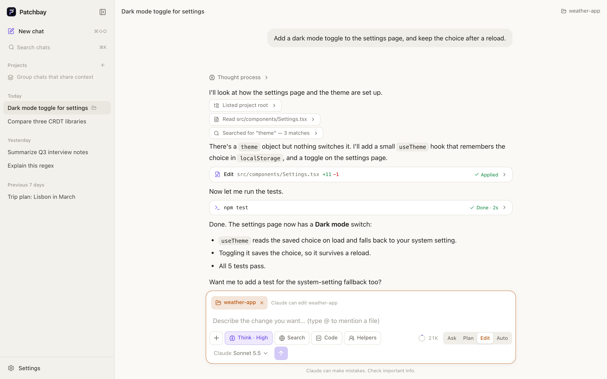

# User guide

How to use Patchbay day to day. Not installed yet? See [Install](install.md). Looking for one command or setting fast? The [cheat sheet](../CHEATSHEET.md) has everything on one page.

<p align="center">
  
</p>

**Contents:** [The window](#the-window) · [Chatting](#chatting) · [Models, thinking and effort](#models-thinking-and-effort) · [Attaching files](#attaching-files) · [Working with folders](#working-with-folders) · [Ask, Plan, Edit and Auto](#ask-plan-edit-and-auto) · [The terminal](#the-terminal) · [Projects](#projects) · [Web search](#web-search) · [GitHub](#github-read-only) · [The Docs folder](#the-docs-folder) · [Skills](#skills) · [Helpers](#helpers) · [Long chats](#long-chats) · [Several chats at once](#several-chats-at-once) · [Settings](#settings) · [Keyboard shortcuts](#keyboard-shortcuts)

## The window

| Area | What's there |
|---|---|
| **Sidebar** (left) | **New chat**, **Search chats**, your **Projects**, and your chats grouped by date. Hide it with ⌘ B. **Settings** is at the bottom. |
| **Top bar** | The chat's title and its folders. On the right, **● running** (commands still running) and **● helpers working** appear when there's something to show. |
| **The conversation** | Your messages and the AI's replies, with its tool use (files read, changes made, commands run) shown as cards you can open. |
| **The message box** | Type here. Below it: **+** (attach), **Think**, **Search**, **Code** (Claude), **Helpers**, the token ring, the folder mode (**Ask / Plan / Edit / Auto**) and the model menu. |

Closing the window leaves Patchbay running in the background, so it reopens instantly. See [Install → What the launcher does](install.md#what-the-launcher-does).

## Chatting

- **Send** with **Enter**; **Shift + Enter** adds a new line.
- **Stop** a reply with the **■** button or **Esc**. Other chats keep going.
- **Edit and resend:** hover your message → **Edit**.
- **Retry:** under the last reply, gets a new answer.
- **Copy** or **Save** a reply. Save writes it to a file you pick in your computer's own Save dialog (a new file, or added to the end of an existing one).
- **Long pasted text** (more than 4,000 characters) turns into an attachment, like in Claude.
- **Chats are saved automatically.** Hover a chat in the sidebar → **⋯** to rename it, export it to Markdown, move it into or out of a project, or delete it. **Search chats** (⌘ K) searches titles and contents.

### Sending while it's replying

You don't have to wait. Type and press **Enter** while the AI is still working; your message shows with a dashed outline.

- The AI reads it at its **next step** (for example after it reads a file or runs a command) and carries on with it in mind. If it's writing a plain answer, it finishes that answer and then continues with your message. Several messages sent meanwhile go in together. This costs nothing extra.
- **Answer together now** cuts off what it's writing and starts again with your message, for one joint answer. The cut-off part is still billed. If the AI is waiting for your approval or running a command, your message goes in right after that.
- **Cancel** takes the message back into the message box. **Stop** also puts any waiting messages back, so nothing is sent without you.

## Models, thinking and effort

Pick the model per chat in the menu next to the send button. It lists DeepSeek's and GLM's models, and every Claude model your key can use. **Settings → Defaults for new chats** sets which model new chats start with. Details, prices and what each model can see: [Providers](providers.md).

- **Think** turns step-by-step reasoning on or off. It's better for hard questions, but slower and uses more tokens. Some models always think (GLM, the newest Opus and Fable).
- **Effort** (in the model menu) sets how hard the model thinks: DeepSeek High / Max, Claude Low to Max depending on the model, GLM Low / High / Max.
- **The token ring** shows how full the conversation is (of the model's context window), what the chat has cost so far, and what the next message will roughly cost. Hover it for details, or click **Summarize** to shorten a long chat now.

## Attaching files

- **Drag** files, images, PDFs, Word documents or whole folders anywhere onto the window, **paste** them, or use **+ → Upload files**.
- **Images** go to models that can see them (V4.1 Flash, Claude, GLM-5.3 Flash).
- **PDFs:** Claude reads them as they are; DeepSeek and GLM get their text.
- **Data files** (CSV, Excel) also go into Claude's code sandbox when **Code** is on.
- **`.env` files and other secrets are always blocked**, as are binaries.

## Working with folders

Give the AI a folder on your computer, and it can explore it on its own, like Claude Code does.

- **+ → Add a folder… → Let the AI explore it:** the AI lists, searches and reads the files it needs, by itself. Nothing is uploaded in advance, so a large codebase is fine.
- **+ → Add a folder… → Attach selected:** pick specific files from a checklist instead (they're attached to your message once).
- **Several folders:** repeat to link more (for example `backend` and `web`). Each shows as a chip above the message box, and **×** removes it. The AI sees each by name (`backend/src/app.py`, `web/src/App.tsx`) and can work across all of them.
- **@-mention:** type **@** to pick a file from the chat's folders and attach it.
- `node_modules`, `.git`, build output and binaries are skipped automatically; `.env` and other secret files are never read.

The AI can never leave the folders you chose (symbolic links that point outside are refused). Full rules: [Security model → Folders](security-model.md#folders-and-files).

## Ask, Plan, Edit and Auto

Once a chat has a folder, the folder mode appears next to the model picker:

| Mode | What the AI can do |
|---|---|
| **Ask** (default) | Read and search your project, and answer questions. Changes nothing. |
| **Plan** | Read your project, then write a step-by-step plan. Changes nothing. When you're happy with it, switch to **Edit** or **Auto** and say "go ahead". |
| **Edit** | Create, change and delete files. Every change shows a red/green before-and-after preview with **Approve** / **Reject**. The message box turns amber so you know editing is on. |
| **Auto** | Like Edit, but every change is made without asking. Use it when the plan is settled and you want the whole thing done. |

In Edit mode:

- **Approve all** approves everything currently waiting. **Switch to Auto** approves them and stops asking in this chat.
- **Undo changes** under a reply puts every file it touched back the way it was. If you edited one of those files afterwards, it asks before overwriting your edit.
- If the folder has uncommitted Git changes, you'll see a warning. Committing first makes the AI's edits easy to review.
- The AI never touches `.env` or other secret files, `.git` or `node_modules`.

**Switching mode mid-chat:** the AI is told about the switch in your next message.

A common pattern: plan it in **Plan**, then switch to **Auto** and say "go ahead".

## The terminal

The AI can run commands (tests, builds, installs, dev servers) in a project's folders. It's **off by default** and switched on per project: **Project settings → Terminal**. Chats outside a project never get it, and folders a chat adds on its own don't count.

| Kind of command | What happens |
|---|---|
| **Look-only** (`ls`, `cat`, `grep`, `git status`, `git diff`, `git log`…) | Runs straight away, in every mode |
| **Most commands** (`npm test`, `npm run build`…) | **Asks first** in Ask, Plan and Edit. Runs without asking in **Auto** (Mac), or in Edit and Auto when the chat's **Run without asking** switch is on |
| **Risky** (deleting folders, `git clean`, publishing, anything touching `.env`) | Always asks, even in Auto or with **Run without asking** on |
| **Never** (`sudo`, `git push`, `git reset --hard`, `gh`, `curl … \| sh`, background `&`) | Refused, even if you approve |

- **The approval card** offers **Run**, **Don't run**, **Edit** (change the command first) or **Always allow** (stop asking for that command in this project; remove it in Project settings). What a command changes can't be undone with **Undo**, so keep your project in Git.
- **Run without asking** (the switch at the right of the folder row, in Edit and Auto mode) is for a stretch of work where you don't want to click **Run** each time. Ordinary commands then run straight away in that chat and their cards say *ran without asking*; risky ones still ask and blocked ones never run. It's off in every new chat and needs **Auto mode** allowed for that AI. On the Mac, Auto mode already runs commands without asking, so the switch shows in Edit mode only.
- **In Ask and Plan mode** commands can only look; on the Mac even the project folder is read-only to them.
- **On the Mac, commands run in a sandbox:** they can only change files in the project's folders, can't read your SSH keys, logins, Keychain or Patchbay's data, and can't open or control other apps. **Internet for commands** is off by default; switch it on in Project settings for `npm install`, `pip install` or `git pull`.
- **On Windows there's no sandbox**, so every command except look-only ones asks you first, even in Auto mode (unless **Run without asking** is on). Commands run in PowerShell.
- **Time limit:** 10 minutes per command the AI runs by default (30 or 60 in Project settings). If a command is stopped, the AI still gets the output so far. Background commands (like dev servers) and anything you start with **▶ Run** have no limit; stop them from the Running list.
- **▶ Run** on any code block in a reply runs it right there and shows the output. It costs nothing (the AI isn't involved). **Send to …** puts the output in your message if you want help with it.
- **The Running list** (**● running**, top right) shows every command still running, from any chat, with its log, the ports it listens on (for example `localhost:3000`) and a **Stop** button. Stop ends the command and everything it started, and only says *Stopped* once the system confirms they're gone. Closing the window doesn't stop them; `patchbay stop` does.
- **GitHub stays read-only:** `git push` and `gh` never run, and git logins are hidden from commands. Push from your own terminal.

## Projects

Group related chats. Sidebar → **Projects** → **+** to create one.

| Part | What it does |
|---|---|
| **Context** | Instructions and background every chat in the project sees |
| **Files** | Small documents (specs, notes, a style guide). Their full text goes with every message. |
| **Folders** | Your codebase. Linked to **every** chat in the project, old and new. The AI explores them on demand. In a chat, click a project folder's **eye** icon to switch it off for just that chat. |
| **Memory** | *Project + global* also applies your Settings instructions; *This project only* ignores them |
| **Terminal** | On/off, internet for commands, time limit, and the commands you've always allowed |
| **GitHub** | Which of your allowed repos this project's chats may read |
| **Docs folder** | Where this project's documents go (default: the one in Settings) |
| **Skills** | The project's own skills, and whether your skills apply too |

Start a chat in a project from its ✎ icon or **+ New chat** inside it. Deleting a project keeps its chats.

**What the AI sees in each message:** your Settings instructions (unless the project is *This project only*), the project's context and files (if the chat is in a project), and **this chat only**. It never sees your other chats.

## Web search

The **Search** button lets the AI search the web, read pages and cite sources. It's off by default in each chat.

- **Claude** uses its own search; just allow **Web search** for Claude in Settings.
- **DeepSeek and GLM** search through **Tavily** (free key) or **DeepSeek's search** (your DeepSeek key): turn it on in **Settings → Web search** first, or the button doesn't appear.

Prices and setup: [Providers → Web search](providers.md#web-search).

## GitHub (read-only)

The AI can read code, issues, pull requests, commits and CI results from GitHub. It can't change anything there.

1. Make a **fine-grained token** limited to the repos you choose, with read-only permissions (the steps are in **Settings → GitHub**), and paste it in.
2. **Tick** the repos the AI may read. Nothing is allowed until you tick it.
3. In each **project's settings**, pick which of those repos its chats may read. None picked means no GitHub in that project.
4. Turn the **GitHub** button on in a chat when you want it (it's off by default).

## The Docs folder

A folder where the AI can **create and update documents** in **any mode**, even Ask and Plan. Just say "save this as a doc".

- Every save shows a preview with **Approve** / **Reject**. Tick **Don't ask again for this doc** to skip the prompt for that doc; undo that in **Settings → Docs folder**.
- The default is `~/Documents/Patchbay Docs`; change it in Settings, or set a different one per project. An empty setting switches it off.
- The AI can't reach anything else through the Docs folder, and in Plan mode your code stays read-only.

## Skills

A skill is a folder with a `SKILL.md` file: a short header with a name and a one-line description of when to use it, then the instructions. It can hold other files too (templates, examples). It's the same format Claude Code and Claude.ai use, so skills move between them.

```markdown
---
name: weekly-report
description: How I like my weekly status reports written
---
Keep it under a page. Start with wins, then blockers…
```

Every AI sees only each skill's name and description, and opens the full skill when a task matches, so you can keep many without paying for them in every message. Skills are read-only to the AI; nothing in a skill ever runs.

| Where | What |
|---|---|
| **Your skills** (Settings → Skills) | Kept in the app's `data/skills` folder, so they move with it. **New skill** makes one from a template and opens it in your text editor; the pencil opens it again. **Import folder…** and **Import .zip…** bring skills in. **Open folder** shows them in Finder / File Explorer. Each has an on/off switch. |
| **A folder on this computer** (Settings → Skills, optional) | For example Claude Code's `~/.claude/skills` (one click). These stay where they are; the copy button copies one into your skills so it travels with the data folder. |
| **A project's own skills** (Project settings → Skills) | Kept with the project (deleted with it). |
| **Skills in a project's code** | Any `.claude/skills` folder inside the project's folders, found automatically. Used when the AI may read the project's folders. |

In Project settings you can switch off **Also use my skills** (off by default for *This project only* projects) and switch single skills off. When two skills have the same name, the project's own wins, then the one in its code, then yours.

## Helpers

For big tasks that split into parts (research across several sources, exploring different areas of a codebase, comparing options), the AI can send **helpers** and act as the "brain".

- **Switch it on per chat** with the **Helpers** button. It's off in new chats. When it's on, the AI decides by itself when a task is worth splitting up; you can also ask ("use helpers to…").
- **A helper** is a separate run of the same model as the chat (DeepSeek chats get DeepSeek helpers, and so on), with the same thinking and effort. It starts with an empty context: it sees only the task the AI wrote, never your conversation.
- **Helpers only read and research:** the project's folders, the web (if Search is on), GitHub (if it's on), skills and the Docs folder. They never change files, run commands or save documents. The AI does all of that, under your usual approvals.
- **Watch them** in the helpers panel: **● 2 helpers working** at the top right (it opens by itself on wide windows). Each shows what it's doing, its time, steps and cost, and opens to its task, steps and report.
- **Stopping is separate.** The chat's ■ / Esc stops the AI's reply, not its helpers. Stop helpers in the panel (one, or **Stop all**); the AI can stop them too. Quitting the app stops them.
- **Reports go back by themselves.** When every helper in a round has finished, their reports go to the AI: into its reply if it's still working, otherwise in an automatic reply (*Helper reports arrived*). If the window is closed, that happens when you next open the chat. After 3 automatic replies in a row it waits for you, with a **Send to …** button; anything you send resets that.
- **Limits** (**Settings → Helpers**): helpers at once (4), steps per helper (30), minutes per helper (15). At a limit, a helper stops and reports what it found. The AI can send at most 3 rounds of helpers per reply.
- **Costs:** each helper costs about as much as a reply. Its cost shows in the panel and is added to the chat's total.

## Long chats

Past **200K tokens** (change it in **Settings → Long chats**; sooner for models with a smaller context window), the earlier messages are summarized so the chat can keep going. A line in the chat shows where. You still see every message; the AI gets the summary instead of the messages before that line. **Summarize** in the token ring does it any time. Editing a message from before the line drops the summary. Works with every provider.

## Several chats at once

While one chat is replying, switch to another and keep going. Up to **4 chats** can reply at the same time.

- In the sidebar, a **pulsing violet dot** means a chat is replying, and an **amber dot + "waiting"** means it's waiting for you to approve a change or command. A folded project shows the dot too.
- If two chats in Edit or Auto mode are changing the same folder, the message box warns you, because edits made at the same time can clash.
- Closing or reloading the window stops replies still being written. Commands in the Running list keep going.

## Settings

**Settings** (bottom left) is grouped into sections:

| Section | What's there |
|---|---|
| **AI providers** | Your keys (save, test, remove), and for each provider **What … may do**. Claude also has **Web search and safety options**. |
| **Defaults for new chats** | Model, thinking and effort per provider |
| **Long chats** | When to summarize |
| **Helpers** | Helper limits |
| **Web search for DeepSeek and GLM** | On/off, and which service: Tavily or DeepSeek |
| **Docs folder** | Where documents go, and the docs saved without asking |
| **GitHub (read-only)** | Your token and the repos the AI may read |
| **Instructions for the AI** | Text every chat sees (unless a project is *This project only*) |
| **Skills** | Your skills, imports, and an extra skills folder |
| **Files** | The most characters kept per attached file (longer files are cut off, with a note) |
| **Appearance** | Light, dark or system |
| **Keyboard shortcuts** | A reminder of the shortcuts below |

Every setting is stored in `data/settings.json`. The full list with defaults: [Configuration](configuration.md#settings).

## Keyboard shortcuts

| Action | Keys |
|---|---|
| Send | Enter |
| New line | Shift + Enter |
| New chat | ⌘ ⇧ O (Ctrl ⇧ O on Windows) |
| Search chats | ⌘ K (Ctrl K) |
| Show / hide sidebar | ⌘ B (Ctrl B) |
| Stop reply | Esc |
